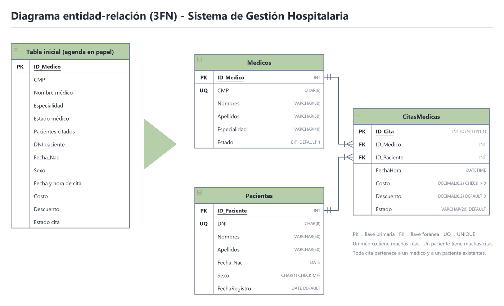

# Práctica Calificada 04 – Caso 2: Sistema de Gestión Hospitalaria Integral

Entregables: **script** (`Script_Caso2_Hospital.sql`) · **diagrama** (`Diagrama_ER_Hospital.png`) · **diapositivas**.
Solo se usa lo visto en clase (normalización de la semana 6 y T-SQL de las semanas 9, 10 y 11).

---

## 1. Normalización (método de la semana 6)

### Tabla inicial: la agenda médica en papel (sin normalizar)

| ID MÉDICO | CMP | NOMBRE MÉDICO | ESPECIALIDAD | PACIENTES CITADOS |
|---|---|---|---|---|
| 1 | 045123 | Carlos Quispe Huamán | Cardiología | Ana Torres Lazo, Pedro Salazar Núñez |
| 2 | 052874 | María Rojas Pérez | Pediatría | Rosa Cárdenas Vega, Lucía Poma Quispe |
| 3 | 061390 | Jorge Mendoza Ríos | Traumatología | Luis Huamán Soto |

❌ **Datos no atómicos:** `PACIENTES CITADOS` tiene varios valores separados por comas.

**Anomalías:**
- **De actualización:** si un paciente cambia de nombre, hay que buscarlo dentro de los textos de cada médico.
- **De inserción:** no se puede registrar a un paciente que todavía no tiene cita.
- **De eliminación:** si se borra al Dr. Mendoza, también se pierde que Luis Huamán es paciente de la clínica.

### 1FN: separamos en diferentes filas

| ID MÉDICO | CMP | NOMBRE MÉDICO | ESPECIALIDAD | DNI PACIENTE | NOMBRE PACIENTE | FECHA Y HORA | COSTO |
|---|---|---|---|---|---|---|---|
| 1 | 045123 | Carlos Quispe Huamán | Cardiología | 70123456 | Ana Torres Lazo | 2026-11-16 08:00 | 180.00 |
| 1 | 045123 | Carlos Quispe Huamán | Cardiología | 73456789 | Pedro Salazar Núñez | 2026-11-17 11:00 | 150.00 |
| 2 | 052874 | María Rojas Pérez | Pediatría | 72345678 | Rosa Cárdenas Vega | 2026-11-17 10:00 | 200.00 |
| 2 | 052874 | María Rojas Pérez | Pediatría | 74567890 | Lucía Poma Quispe | 2026-11-18 15:00 | 120.00 |
| 3 | 061390 | Jorge Mendoza Ríos | Traumatología | 71234567 | Luis Huamán Soto | 2026-11-16 09:00 | 90.00 |

✔ Cada celda tiene un solo valor, así que **cumple la 1FN**. La clave es `ID MÉDICO + DNI PACIENTE + FECHA Y HORA`.
❌ Todavía hay redundancia: los datos del Dr. Quispe y de la Dra. Rojas se repiten.

### 2FN: eliminamos las dependencias parciales

- `CMP`, `NOMBRE MÉDICO` y `ESPECIALIDAD` dependen **solo** de `ID MÉDICO` (una parte de la clave) → pasan a la tabla **MEDICOS**.
- `NOMBRE PACIENTE` depende **solo** de `DNI PACIENTE` (otra parte de la clave) → pasa a la tabla **PACIENTES**, con su propio `ID_PACIENTE`.
- `FECHA Y HORA` y `COSTO` dependen de la cita completa → quedan en **CITASMEDICAS**. Esta tabla une médicos y pacientes **sin perder información**, como la tabla intermedia de la clase.

**MEDICOS**

| ID_MEDICO | CMP | NOMBRE | ESPECIALIDAD |
|---|---|---|---|
| 1 | 045123 | Carlos Quispe Huamán | Cardiología |
| 2 | 052874 | María Rojas Pérez | Pediatría |
| 3 | 061390 | Jorge Mendoza Ríos | Traumatología |

**PACIENTES**

| ID_PACIENTE | DNI | NOMBRE |
|---|---|---|
| 1 | 70123456 | Ana Torres Lazo |
| 2 | 71234567 | Luis Huamán Soto |
| 3 | 72345678 | Rosa Cárdenas Vega |
| 4 | 73456789 | Pedro Salazar Núñez |
| 5 | 74567890 | Lucía Poma Quispe |

**CITASMEDICAS**

| ID_CITA | ID_MEDICO | ID_PACIENTE | FECHA Y HORA | COSTO |
|---|---|---|---|---|
| 1 | 1 | 1 | 2026-11-16 08:00 | 180.00 |
| 2 | 3 | 2 | 2026-11-16 09:00 | 90.00 |
| 3 | 2 | 3 | 2026-11-17 10:00 | 200.00 |
| 4 | 1 | 4 | 2026-11-17 11:00 | 150.00 |
| 5 | 2 | 5 | 2026-11-18 15:00 | 120.00 |

### 3FN: eliminamos las dependencias transitivas

- En `CITASMEDICAS` **no** se guarda la especialidad ni el nombre del médico. Si estuvieran ahí, dependerían de `ID_MEDICO` y no de `ID_CITA`. Eso es una dependencia transitiva: `ID_CITA → ID_MEDICO → ESPECIALIDAD`. Lo mismo pasaría con el nombre del paciente.
- En las 3 tablas, cada atributo depende **solo** de su PK, así que **cumple la 3FN**.
- **FNBC:** el `CMP` y el `DNI` también determinan los datos del médico y del paciente, pero son `UNIQUE`, es decir, superclaves. Por eso también cumple la FNBC.
- Para terminar, el nombre se separa en `Nombres` y `Apellidos` (valores atómicos) y se agregan los demás atributos de cada entidad: `Estado`, `Fecha_Nac`, `Sexo`, `FechaRegistro` y `Descuento`. Todos dependen directamente de su PK. El resultado son las 3 tablas del diagrama y del script.

---

## 2. Diseño lógico (diagrama)



- **Tablas padre:** `Medicos` y `Pacientes`. **Tabla hijo:** `CitasMedicas`, que guarda las dos FK.
- Un médico tiene muchas citas y un paciente tiene muchas citas (relación 1 a muchos).

### Justificación de tipos de datos

| Campo | Tipo | ¿Por qué? |
|---|---|---|
| `ID_Medico`, `ID_Paciente` | `INT PRIMARY KEY` | Número entero que identifica cada fila; no se repite ni puede quedar vacío |
| `ID_Cita` | `INT IDENTITY(1,1)` | SQL Server genera el número solo (1, 2, 3…) |
| `CMP` | `CHAR(6)` | Longitud **fija**: siempre mide 6 caracteres |
| `DNI` | `CHAR(8)` | Longitud **fija**: siempre mide 8 caracteres |
| `Nombres`, `Apellidos`, `Especialidad`, `Estado` (de la cita) | `VARCHAR(n)` | Longitud **variable**: ahorra espacio porque usa solo lo que necesita |
| `Sexo` | `CHAR(1)` | Longitud **fija** de 1 carácter: `M` o `F` |
| `Fecha_Nac`, `FechaRegistro` | `DATE` | Guarda fechas en formato año-mes-día |
| `FechaHora` | `DATETIME` | Una cita necesita el día **y la hora** |
| `Costo`, `Descuento` | `DECIMAL(8,2)` | Dinero exacto con 2 decimales; en finanzas se prefiere DECIMAL a FLOAT |
| `Estado` (médico) | `BIT` | Solo admite 1 (activo) o 0 (inactivo) |

---

## 3. Qué parte del script cumple cada requisito

| Requisito del caso | En el script |
|---|---|
| CMP irrepetible | `CONSTRAINT UQ_Medicos_CMP UNIQUE (CMP)` |
| Regla lógica del costo | `CHECK (Costo > 0)` y `CHECK (Descuento >= 0)` |
| Otras reglas CHECK | `CHECK (Sexo = 'M' OR Sexo = 'F')` |
| Una cita siempre pertenece a un médico y a un paciente | `FOREIGN KEY ... REFERENCES` + `NOT NULL` en `ID_Medico` e `ID_Paciente` |
| DEFAULT | `Estado DEFAULT 1` (médico), `FechaRegistro DEFAULT GETDATE()` (paciente), `Descuento DEFAULT 0` y `Estado DEFAULT 'Programada'` (cita) |
| 3 médicos, 5 pacientes, 5 citas | `INSERT INTO ... VALUES` (Paso 1) |
| Algoritmo iterativo de descuentos | `WHILE` + `IF...ELSE` + `UPDATE` entre `BEGIN TRAN` y `COMMIT` (Paso 3) |
| Olvido digital sin error | `DELETE` de las citas (hijo) y luego del paciente (padre), entre `BEGIN TRAN` y `COMMIT` (Paso 4) |

### Paso 2: comprobación de las reglas (los errores en rojo son esperados)

```
Msg 2627  Violation of UNIQUE KEY constraint 'UQ_Medicos_CMP' ... (045123)
Msg 547   conflicted with the CHECK constraint "CK_Cita_Costo"
Msg 547   conflicted with the FOREIGN KEY constraint "FK_Cita_Medico"
```

### Paso 3: descuentos (resultado real)

| Paciente | Costo antes | Regla | Costo después | Descuento |
|---|---|---|---|---|
| 1 – Ana Torres | 180.00 | > 150 → −50 | **130.00** | 50.00 |
| 2 – Luis Huamán | 90.00 | ≤ 150 → −20 | **70.00** | 20.00 |
| 3 – Rosa Cárdenas | 200.00 | > 150 → −50 | **150.00** | 50.00 |
| 4 – Pedro Salazar | 150.00 | ≤ 150 → −20 | **130.00** | 20.00 |
| 5 – Lucía Poma | 120.00 | ≤ 150 → −20 | **100.00** | 20.00 |

El `WHILE @i <= 5` recorre los pacientes del 1 al 5. El `SELECT @costo = ...` guarda en memoria el costo de su cita, el `IF...ELSE` decide el descuento, el `UPDATE` resta el monto y lo anota en `Descuento`, y `SET @i += 1` pasa al siguiente paciente.

### Paso 4: olvido digital (paciente 4)

- `DELETE FROM Pacientes WHERE ID_Paciente = 4` **solo** daría error, porque el paciente todavía tiene una cita (`FK_Cita_Paciente`).
- **Solución:** primero se borran sus citas (tabla hijo) y después el paciente (tabla padre). Así no se genera ningún error.
- Es la misma **anomalía de eliminación** de la normalización, pero resuelta: al borrar al paciente no se pierde ningún dato del médico, porque está en su propia tabla.

---

## 4. Guion de diapositivas

1. **Portada:** curso, Caso 2, integrantes y responsable de la entrega.
2. **Planteamiento del caso:** clínica que pasa del papel a SQL Server.
3. **Tabla inicial y anomalías:** la agenda en papel.
4. **1FN y 2FN:** separar en filas y luego en tablas.
5. **3FN y FNBC:** sin dependencias transitivas.
6. **Diagrama entidad-relación:** `Diagrama_ER_Hospital.png`.
7. **Tipos de datos:** la tabla de justificación.
8. **Restricciones:** el `CREATE TABLE` (UNIQUE, CHECK, DEFAULT, FK) y los 3 errores del Paso 2.
9. **Descuentos:** el código del `WHILE` + `IF...ELSE` y la tabla antes/después.
10. **Olvido digital:** por qué falla el borrado directo y la solución con `BEGIN TRAN` / `COMMIT`.
11. **Conclusiones.**
